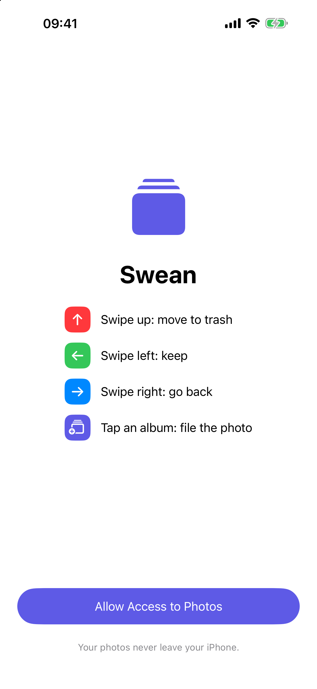
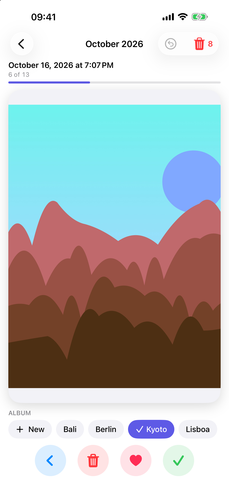
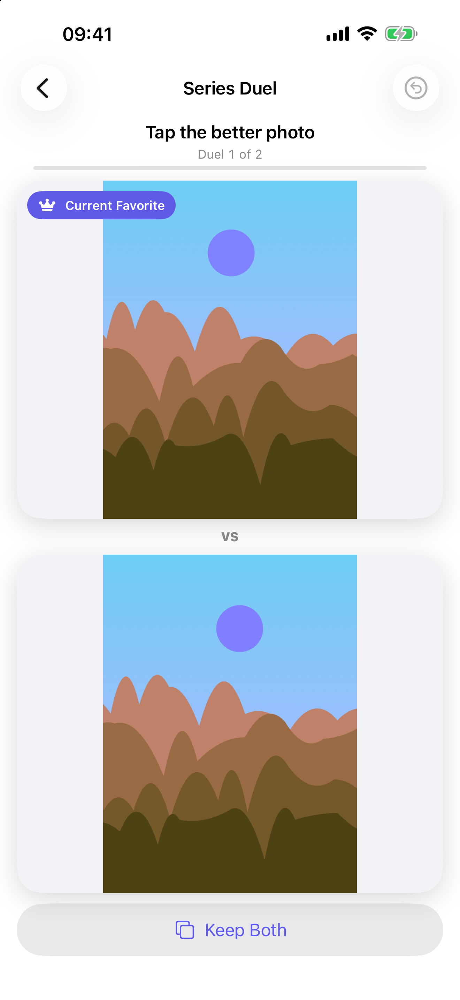

# Swean

Swean helps you clean up your photo library on iPhone. Swipe photos up to move them to the trash, swipe left to keep them, and file them into albums with a tap. **Series Duel** finds series of near-identical shots and lets them compete until the best one remains.

Everything happens on your device — no account, no servers, no analytics, no third-party SDKs.

<p align="center">
  
  
  
</p>

## Features

- **Swipe to review** — up to trash, left to keep, tap to file into an album or mark as favorite.
- **Safe trash** — swiped photos land in Swean's own trash first; nothing is deleted until you confirm there (and iOS keeps them in "Recently Deleted" for 30 days).
- **Series Duel** — groups photos taken seconds apart and compares them on-device with Vision feature prints (with a pixel-based fallback, e.g. in the Simulator), then lets you pick the best shot head-to-head.
- **Progress tracking** — remembers which photos you've already reviewed; reset any time.
- **Light and dark mode**, localized in English and German.

## Requirements

- iOS 17.0 or later
- Xcode with Swift 5 / SwiftUI support

## Building

1. Clone the repository:
   ```bash
   git clone https://github.com/mathiassiegmund/swean.git
   ```
2. Open `Swean.xcodeproj` in Xcode.
3. Select the **Swean** scheme, set your own development team and bundle identifier under *Signing & Capabilities*, and run on a device or simulator.

Series detection works best on a real device; the Simulator falls back to a simpler pixel comparison.

## Project structure

| Path | Contents |
| --- | --- |
| `Swean/` | App source (SwiftUI views, photo library access, series detection, review state) |
| `Swean/Localizable.xcstrings` | English and German strings |
| `AppStore/Screenshots/` | App Store screenshots (en/de) |
| `PRIVACY.md` | Privacy policy |
| `SUPPORT.md` | Support page and FAQ |

## Privacy

Swean does not collect, store or share any personal data. Photos never leave your device. See [PRIVACY.md](PRIVACY.md) for details.

## Support

Questions and FAQ: [SUPPORT.md](SUPPORT.md).

## License

Released under the [MIT License](LICENSE).
